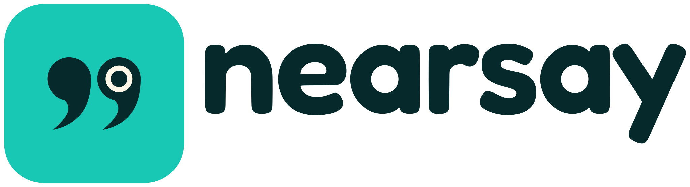
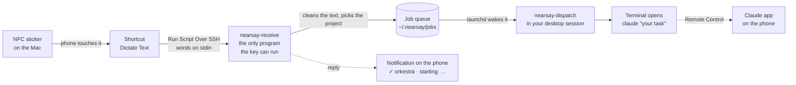

<p align="center">
  <picture>
    <source media="(prefers-color-scheme: dark)" srcset="docs/assets/brand/nearsay-logo-reversed.svg">
    
  </picture>
</p>

<p align="center">
  <a href="https://github.com/andyyaro/nearsay/actions/workflows/tests.yml"></a>
  <a href="LICENSE"></a>
  
  
  
  
  <a href="tests/test_e2e_ssh.py"></a>
</p>

<p align="center"><b>Hold your phone near. Say the task. A coding session starts on your Mac.</b></p>

<p align="center">
  <a href="#quick-start">Quickstart</a> |
  <a href="docs/IPHONE.md">iPhone setup</a> |
  <a href="#how-it-works">How it works</a> |
  <a href="#using-it">Using it</a> |
  <a href="docs/THREAT_MODEL.md">Security model</a> |
  <a href="docs/TROUBLESHOOTING.md">Troubleshooting</a> |
  <a href="CHANGELOG.md">Changelog</a>
</p>

**nearsay** is a voice launcher for Claude Code. Hold your iPhone to an NFC sticker on your Mac,
say what you want done, and a Claude Code session starts on the Mac, in the right project,
already working on it.

| | Runs on | What it does |
|---|---|---|
| **The phone side** | iPhone Shortcuts, one NFC automation | Listens to you, then sends the words to the Mac over SSH. Three Shortcut actions, nothing to install. |
| **The Mac side** | `~/.nearsay`, one LaunchAgent, your terminal | Checks the words, picks the project, and starts `claude` with your task in a new terminal window. Standard-library Python, no `pip install`. |

The Mac side is quick: in the test suite an SSH connection plus the receiver takes about 0.4 s,
and dispatching takes about 0.05 s per task, on one machine. Wi-Fi, dictation noticing that you
stopped talking, and the terminal window opening add the rest, and those depend on your phone
and network.

## How it works



The phone's key can start one program and nothing else. That program never runs a shell: your
words travel as data, from standard input to a file to one argument to `claude`. The dispatcher
runs inside your logged-in desktop session, not over SSH, because only that session can open
windows and reach folders such as `~/Documents`.

### The pieces, in plain terms

| Term | What it is | Its job here |
|---|---|---|
| **NFC sticker** | A thin sticker with a tiny chip and antenna. NFC (near-field communication) is the short-range radio your iPhone also uses for Apple Pay. The phone reads it from about 1–4 cm away. | The physical "button" on your Mac. The sticker needs no programming: the iPhone recognizes it by the chip's built-in serial number. |
| **Shortcut** | A small program you build by stacking actions in Apple's Shortcuts app. | Listens to you (the *Dictate Text* action) and sends the words to the Mac (the *Run Script Over SSH* action). |
| **Automation** | A Shortcuts rule of the form "when X happens, run this." | "When this NFC sticker is touched, run the Shortcut." |
| **SSH** | Secure Shell, the standard encrypted way to run a command on another computer. macOS has it built in as *Remote Login*. | Carries your words from the phone to the Mac. The phone's key is locked to one program, so it cannot do anything else. |
| **Receiver** (`nearsay-receive`) | The only program the phone's key is allowed to start. | Cleans up the text, decides which project it is for, and drops a small job file into a queue folder. |
| **LaunchAgent** | A background job that macOS's service manager (`launchd`) runs for you, inside your logged-in session. | Starts the dispatcher only when a job file appears, so nothing runs between taps. |
| **Dispatcher** (`nearsay-dispatch`) | Runs as you, in your desktop session. | Opens the terminal and starts Claude Code. |
| **Remote Control** | A Claude Code feature that mirrors a session running on your Mac into the Claude app on your phone. | After the tap, the same session appears in the Claude app (Code tab), so you can watch or reply from your phone. Needs a Pro, Max, Team or Enterprise claude.ai login. |

## Quick start

### What you need

- **An iPhone XS or newer.** Older models cannot read NFC tags in the background.
- **A Mac with Claude Code installed and signed in** (`claude` works in Terminal).
- **Python 3.9 or newer on the Mac.** Apple's Command Line Tools provide it (`xcode-select --install` if `python3 --version` asks to install something). Nothing is installed with `pip`.
- **An *on-metal* NFC sticker** (also sold as "anti-metal"), NTAG213 or NTAG215, roughly 25–30 mm. A MacBook's aluminum case blocks ordinary NFC stickers; on-metal stickers have a ferrite layer between the chip and the adhesive that shields the antenna from the metal. Ordinary stickers work fine on plastic, wood or a desk.
- **The phone and Mac on the same network,** or both on [Tailscale](https://tailscale.com) for use away from home (see [docs/IPHONE.md](docs/IPHONE.md#away-from-home)).

> **"Press and hold":** an NFC sticker is passive, so it cannot sense a finger. You hold the
> *phone* against the sticker for a moment instead. If you want a real button you press with
> your finger, a Bluetooth button that can run a Shortcut works with the same Mac side unchanged.

### Install on the Mac (about 5 minutes)

```bash
git clone https://github.com/andyyaro/nearsay.git ~/code/nearsay
cd ~/code/nearsay
./install.sh
```

The installer copies the code to `~/.nearsay`, creates a default project called `inbox`
(`~/nearsay-inbox`), loads the dispatcher agent, puts `nearsay` on your PATH, and runs a checkup.
It is safe to re-run; it keeps your settings.

Then:

1. **Turn on Remote Login.** System Settings → General → Sharing → click ⓘ next to Remote Login → turn it on → *Allow access for: Only these users* → just you. Leave *Allow full disk access for remote users* **off**; nearsay does not need it.
2. **If macOS shows "Background Items Added,"** leave it allowed (System Settings → General → Login Items & Extensions). That entry is the dispatcher.
3. **Add your projects:**
   ```bash
   nearsay project add orkestra ~/code/orkestra --alias orchestra --default
   nearsay project add provalume ~/code/provalume --permission-mode acceptEdits
   ```
   `--alias` adds other spellings dictation might produce. `nearsay route "In orchestra, add tests"` shows which project a sentence would go to, without starting anything.
4. **Check everything:** `nearsay doctor` (it lists every problem with the exact fix).
5. **Try the Mac side alone:** `nearsay test "In inbox, list the files here"` should open a terminal with Claude working.

### Set up the iPhone (about 5 minutes)

Run `nearsay phone` on the Mac; it prints every value you need to type. Then follow
**[docs/IPHONE.md](docs/IPHONE.md)**. In short:

1. Build a Shortcut called **nearsay** with three actions: *Dictate Text* → *Run Script Over SSH* (Input: Dictated Text, Script: `tap`) → *Show Notification* (Shell Script Result).
2. In the SSH action, choose *SSH Key*, tap the key, *Share Public Key*, send it to the Mac, then on the Mac: `nearsay add-key --from-clipboard`.
3. Automation tab → New Automation → **NFC** → scan your sticker → *Run Immediately* → choose **nearsay**.

Stick the sticker where the top edge of your iPhone can reach it (the NFC antenna is at the top
of the phone): the palm rest corner, the lid's back, or the desk next to the Mac.

## Using it

**Tap, then speak.** The phone listens until you pause (or until you tap Done, if you set
*Stop Listening: On Tap* for longer tasks). Within a second:

- the phone shows `✓ orkestra · starting: add tests for the parser`;
- a terminal opens on the Mac in that project with Claude Code already on the task;
- a macOS notification confirms it; and
- the session appears in the Claude app on your phone (Code tab), named `orkestra: add tests for the parser`.

### Choosing the project by voice

Start your sentence with the project:

| You say | Goes to | Claude receives |
|---|---|---|
| "In orkestra, add tests for the parser." | orkestra | add tests for the parser. |
| "For the provalume project, update the README." | provalume | update the README. |
| "Orkestra: fix the flaky test." | orkestra | fix the flaky test. |
| "Hey Claude, in orchestra add retry logic." | orkestra (alias / sounds-like match) | add retry logic. |
| "Summarize what changed today." | your default project | (the whole sentence) |

Rules that keep this predictable: a routing word ("in", "for", "on", "inside"…) followed by a
project name may match loosely, so dictation spellings still work. A project name on its own
only counts if punctuation follows it ("Orkestra: …"). If two projects sound equally close,
nearsay does not guess and uses the default. Spoken routing beats a sticker's project, so one
sticker can reach everything.

**One sticker per project (optional).** `nearsay sticker add lab provalume`, then give that
sticker its own automation whose Script field is `tap lab`. Details in
[docs/IPHONE.md](docs/IPHONE.md#more-than-one-sticker).

### Three launch modes

Set per project or globally:

| Mode | What happens | Good for |
|---|---|---|
| `run` (default) | Terminal opens and Claude starts on the task immediately. | Everyday use. |
| `review` | Uses Claude Code's own `claude-cli://` link: the task is typed into Claude's prompt box but **not sent** until you press Enter, with a "Prompt from an external link" warning. | Sensitive repositories; checking what dictation heard first. |
| `background` | `claude --bg`: no window; the session runs as a background agent. See it with `claude agents`, join it with `claude attach <id>`. | Long jobs you don't want a window for. |

```bash
nearsay set mode review                                   # everything
nearsay project add orkestra ~/code/orkestra --mode run   # one project
```

The phone may also ask for a mode per tap (`tap mode=review` in the Script field). It can never
change a project's folder, permission mode, model or the `claude` binary; those come only from
the config file on the Mac.

**What was sent, and what happened:** `nearsay log` lists recent taps and their results;
`nearsay show <id>` shows one in full.

## Commands

| Command | What it does |
|---|---|
| `nearsay doctor` | Checks every link in the chain (config, folders, Claude Code, Remote Login, phone key, file permissions, dispatcher agent, queue) and prints the fix for each problem. |
| `nearsay phone` | Prints the values to type into the iPhone Shortcut, your stickers, and the spoken project names. |
| `nearsay project add NAME PATH [--alias A]… [--permission-mode M] [--model M] [--mode run\|review\|background] [--worktree] [--no-remote-control] [--default]` | Adds or updates a project. Re-running updates only the options you give. |
| `nearsay project list \| remove NAME \| default NAME` | Manage projects. Removing a project never touches its folder. |
| `nearsay sticker add NAME PROJECT \| remove NAME \| list` | Name stickers and pin them to projects. |
| `nearsay route "sentence" [--sticker NAME]` | Shows which project a sentence would go to. Starts nothing. |
| `nearsay test "sentence" [--sticker NAME] [--no-launch] [--now]` | Sends a task through the whole Mac-side pipeline as if from the phone. |
| `nearsay add-key --from-clipboard [--label NAME] [--allow-from CIDR]…` | Authorizes the phone's public key, locked to the receiver. `--allow-from` limits it to networks such as `192.168.1.0/24` or Tailscale's `100.64.0.0/10`. |
| `nearsay keys` / `nearsay remove-key [--label NAME]` | List or remove phone keys. |
| `nearsay set KEY VALUE` / `nearsay config` | Change or print settings (table below). |
| `nearsay log [-n N]` / `nearsay show ID` | Recent taps and their outcome. |
| `nearsay install-agent` | Rewrite and reload the dispatcher agent (after changing `claude_path` or `path_env`). |
| `nearsay uninstall [--purge]` | Remove the agent, the phone key and the PATH link. `--purge` also deletes `~/.nearsay`. |

## Settings

Stored in `~/.nearsay/config.json`; change them with `nearsay set KEY VALUE` (validated before
saving) or edit the file and run `nearsay doctor`. A full example is in
[`examples/config.example.json`](examples/config.example.json).

| Setting | Default | Meaning |
|---|---|---|
| `default_project` | `inbox` | Where a task goes when no project is named. |
| `mode` | `run` | `run`, `review` or `background` (projects can override). |
| `permission_mode` | `default` | Claude Code permission mode for tapped sessions: `default` (asks before edits and commands), `acceptEdits`, `plan`, `auto`, `dontAsk`, `bypassPermissions`. Projects can override. `doctor` warns about `bypassPermissions`. |
| `model` | none | Model alias or full name (`opus`, `sonnet`, …); none uses your Claude Code default. |
| `remote_control` | `true` | Start sessions with Remote Control so they appear in the Claude app on your phone. |
| `worktree` | `false` | Start each tapped task in its own git worktree (isolated copy of the repository). |
| `terminal` | `Terminal` | `Terminal`, `iTerm`, `Ghostty`, `kitty`, `Alacritty`, `WezTerm`, or `custom` with `terminal_command` (a JSON list containing `{script}`). |
| `keep_shell` | `true` | After Claude exits, leave a shell open in the project folder. |
| `notify` / `speak` | `true` / `false` | macOS notification and spoken confirmation on the Mac. |
| `claude_path` | found at install | Absolute path to `claude`. |
| `max_task_chars` | `4000` | Longest task accepted. |
| `dedupe_seconds` | `20` | The same task to the same project within this window is treated as an accidental double tap. |
| `linger_seconds` | `15` | How long the dispatcher waits for another tap before exiting. |
| `fuzzy_threshold` | `0.84` | How close a spoken project name must be (0.5–1). Raise it if you get wrong matches; add an alias rather than lowering it. |
| `keep_jobs` | `200` | How many past taps to keep in `~/.nearsay/jobs`. |
| `path_env` | Homebrew + system paths | `PATH` used by the dispatcher (re-run `nearsay install-agent` after changing). |

## Security

The full threat model is **[docs/THREAT_MODEL.md](docs/THREAT_MODEL.md)**; to report a problem,
see **[SECURITY.md](SECURITY.md)**.

- The phone's SSH key is written with `command="…/nearsay-receive",restrict`. Any login with it runs the receiver and nothing else: no shell, no terminal, no port or agent forwarding. Whatever the Shortcut asks to run is treated as a sticker name and validated, never executed. The test suite proves this against a real OpenSSH server.
- Your words travel as data (standard input → a file → one argument to `claude`). They never pass through a shell, and invisible or bidirectional Unicode characters are stripped so what you see is what Claude gets.
- The phone cannot change which folder, permission mode, model or program is used; only the config file on the Mac decides.
- Someone holding your **unlocked** phone can start Claude sessions in your configured projects with the permission mode you chose. Keep `permission_mode` at `default` (Claude asks before acting) or `acceptEdits`, or use `review` mode, for anything important.

## Verification

```bash
./run_tests.sh                       # 109 tests, about 15 s; uses python3
PYTHON=/usr/bin/python3 ./run_tests.sh
```

The suite covers routing (including dictation spellings and false positives), config
validation, the receiver (hostile Script fields, oversize and empty input, double taps), the
launcher (generated scripts are executed with `zsh` and a stand-in `claude` that records exactly
what it received), the dispatcher (bad files, crashes, locking, quick second taps), key
management, the LaunchAgent file, `doctor`, the CLI, the real `install.sh`, and an end-to-end run
through a real OpenSSH server with the restricted key.

The SSH test starts its own `sshd` on a random localhost port with its own config, so it does
not touch Remote Login, and skips itself where `sshd` is unavailable. It checks that the key
cannot open a shell, a terminal or a forwarded port, that a hostile Script field cannot run a
command, and that an `--allow-from` key is refused from any other address.

CI runs the same suite on macOS, with Apple's system Python and a current one, on every push to
`main` and every pull request ([tests.yml](.github/workflows/tests.yml)).

## Known limitations

1. **Host-key checking by Shortcuts is unconfirmed.** It is not documented whether the Shortcuts SSH action verifies the Mac's host key. If it does not, someone who redirects the connection on an untrusted network could read the task you spoke; they still could not run anything on your Mac. Use trusted networks, or Tailscale away from home. See [docs/THREAT_MODEL.md](docs/THREAT_MODEL.md).
2. **The listening panel may differ by iOS version.** iOS should show its small dictation panel when an NFC automation starts *Dictate Text*. Where it shows a keyboard instead, tap the keyboard's microphone key, or use *Ask for Input*. See [docs/IPHONE.md](docs/IPHONE.md).
3. **Tap-to-terminal time on a real phone is not measured.** The numbers above are the Mac side only, from the test suite.
4. **macOS only on the computer side.** The receiver, router and queue are portable Python; the launcher (Terminal, `open`, `launchd`) is macOS-specific.
5. **A MacBook needs an on-metal sticker.** Ordinary NFC stickers do not read through an aluminum case.

## Why it is built this way

**Doesn't Claude already do this?** Partly. *Dispatch* (Pro and Max plans) lets you message a
task from the Claude mobile app to the Claude Desktop app, which can start a Code session.
nearsay differs in three ways: no app to open (one tap and speak), the task goes straight to a
named project folder in a terminal `claude` session with your chosen permission mode, and
routing by voice or by sticker. The two coexist fine; Remote Control makes tapped sessions show
up in the same Claude app.

**Why SSH rather than a small web server?** macOS already ships a hardened SSH server, keys give
strong authentication with no passwords on the wire, and `command=…,restrict` lets the key do
exactly one thing. A web server would add a long-running process, a port, tokens and TLS
certificates to manage.

**Why the queue and LaunchAgent?** Programs started by SSH cannot open windows and are blocked
by macOS privacy controls from `~/Documents`, `~/Desktop` and `~/Downloads`. The dispatcher runs
inside your desktop session, where Terminal and Claude Code have the access they normally have.
The queue also means a tap is never lost if the dispatcher is briefly busy.

**Why can't the Shortcut be imported as a file?** NFC automations are tied to one phone and one
physical sticker, so Apple does not let them be shared; the Shortcut itself is three actions and
takes a couple of minutes to build.

**Android?** The Mac side does not care what sends the text. Any Android automation app that can
run an SSH command with standard input on an NFC tag will work with the same key setup.

## Repository map

| Path | Contents |
|---|---|
| [`nearsay/receive.py`](nearsay/receive.py) | The SSH entry point: the only program the phone's key can run |
| [`nearsay/router.py`](nearsay/router.py) · [`text.py`](nearsay/text.py) | Choosing the project from what you said; cleaning the text |
| [`nearsay/jobs.py`](nearsay/jobs.py) | The job queue between the receiver and the dispatcher |
| [`nearsay/dispatch.py`](nearsay/dispatch.py) · [`launcher.py`](nearsay/launcher.py) | The launchd entry point; opening the terminal, review link or background session |
| [`nearsay/keys.py`](nearsay/keys.py) · [`launchagent.py`](nearsay/launchagent.py) | The restricted `authorized_keys` line; the LaunchAgent file |
| [`nearsay/cli.py`](nearsay/cli.py) · [`doctor.py`](nearsay/doctor.py) · [`config.py`](nearsay/config.py) | The `nearsay` command, its checkup and the validated config |
| [`install.sh`](install.sh) | The installer (copies to `~/.nearsay`, writes the wrappers, loads the agent) |
| [`tests/`](tests/) | The 109-test suite, including the end-to-end SSH run |
| [`docs/`](docs/) | [iPhone setup](docs/IPHONE.md), [threat model](docs/THREAT_MODEL.md), [troubleshooting](docs/TROUBLESHOOTING.md) |
| [`docs/assets/brand/`](docs/assets/brand/) | The nearsay logo, light and dark |

## Uninstall

```bash
nearsay uninstall --purge
```

Then turn off Remote Login if you no longer need it, and delete the automation and Shortcut on
the phone. Your project folders are never touched.

## Project status

Version 1.0.0. First released as **tapclaude** in October 2026 and renamed **nearsay** in
November 2026. If you installed it under the old name,
[CHANGELOG.md](CHANGELOG.md#moving-from-tapclaude) shows how to move over; the Shortcut on your
phone does not change.

Contributions are welcome; see [CONTRIBUTING.md](CONTRIBUTING.md) and the
[code of conduct](CODE_OF_CONDUCT.md).

*License: [MIT](LICENSE).*
